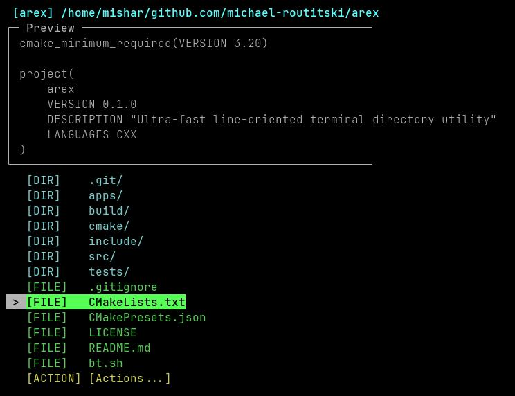
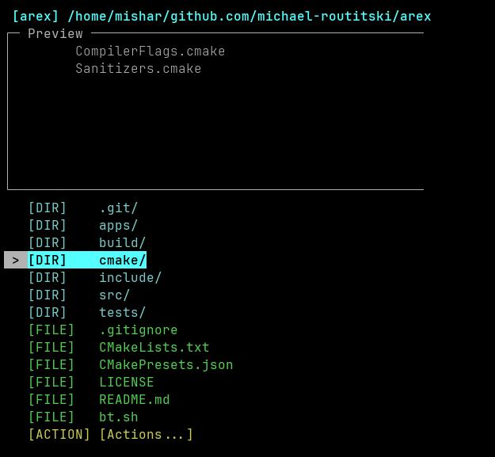
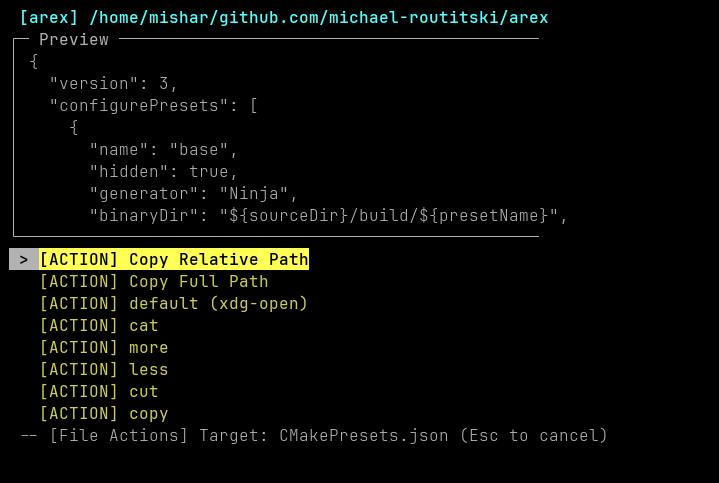

# arex - file system at your fingertips - literally. 

[AR]ow [EX]lorer: Fast ergonomic inline terminal navigation utility driven with arrow or awsd keys.

Written in C++20 with high performance techniques to make the tool very crisp and satisfying.

No external 3rd party lib dependencies. Tested on Debian.

## Installing on Linux

Clone the repo and run `install.sh` script. It will do the full build and drop the executable in your `/usr/local/bin` dir. 

## Quick Preview

Navigate the dir tree in the terminal with arrow keys, awsd or vim keys

Run core basic commands instantly.

## Subtle nod to my favorite car

The mighty Mazda RX3

https://en.wikipedia.org/wiki/Mazda_Grand_Familia#/media/File:Mazda-Savanna.JPG

## TODO:

Test on Mac and Windows
